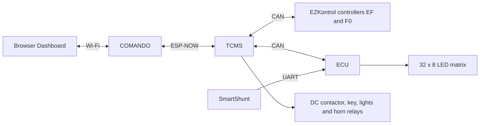

# Microcontrollers and their roles

The firmware contains three independent ESP32 programs. This overview describes their implemented roles.

| Board | Main responsibility | Connected to |
| --- | --- | --- |
| COMANDO | Operator interface and wireless remote | Browser Dashboard over Wi-Fi; TCMS over ESP-NOW |
| TCMS | Traction commands, relay outputs and communication gateway | COMANDO over ESP-NOW; ECU and two motor-controller addresses over CAN |
| ECU | Battery monitoring and LED display | SmartShunt over UART; TCMS over CAN; LED matrix |

## COMANDO: operator interface

Hosts the browser dashboard on its Wi-Fi access point. It forwards speed, current-limit, relay, stop/resume and display-text requests to TCMS. Received motor and battery measurements, faults and logs appear on the dashboard. Serial input also supports relay, horn, stop and zero-speed commands. No physical control buttons or joystick are implemented yet.

## TCMS: onboard control and gateway

Receives remote requests and sends the same speed and current targets to both motor-controller addresses. It handles controller handshakes, reads motor telemetry and operates the four relay outputs. Traction start requires the DC and key software states to be on and the software stop latch to be cleared.

TCMS forwards motor telemetry, ECU battery measurements and logs to COMANDO. It sends relay/stop state and requested display text to ECU. Automatic light selection follows measured RPM direction.

## ECU: battery and display

Reads SmartShunt voltage, current, power and state of charge, then sends them to TCMS over CAN. It drives the LED matrix with blue text, initially `ISTrain`, or blinking red `PARAR` when TCMS reports an operator stop. It also sends diagnostic events to TCMS.

ECU communicates with COMANDO through TCMS. Controls the display and reports battery data.
